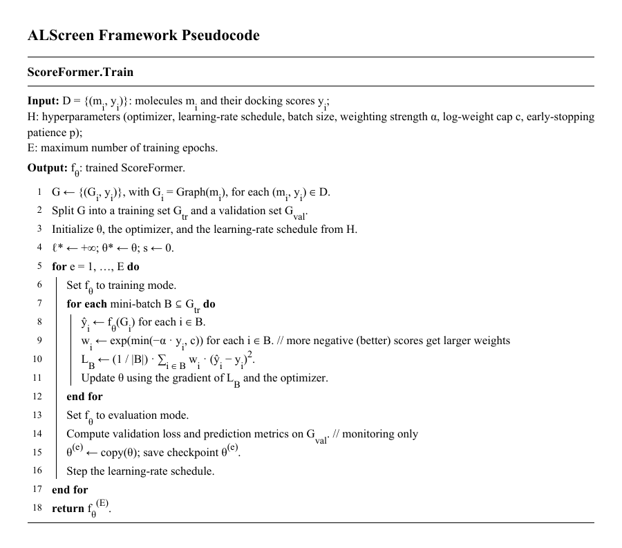
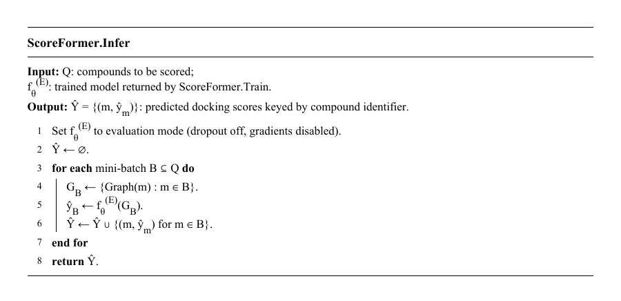
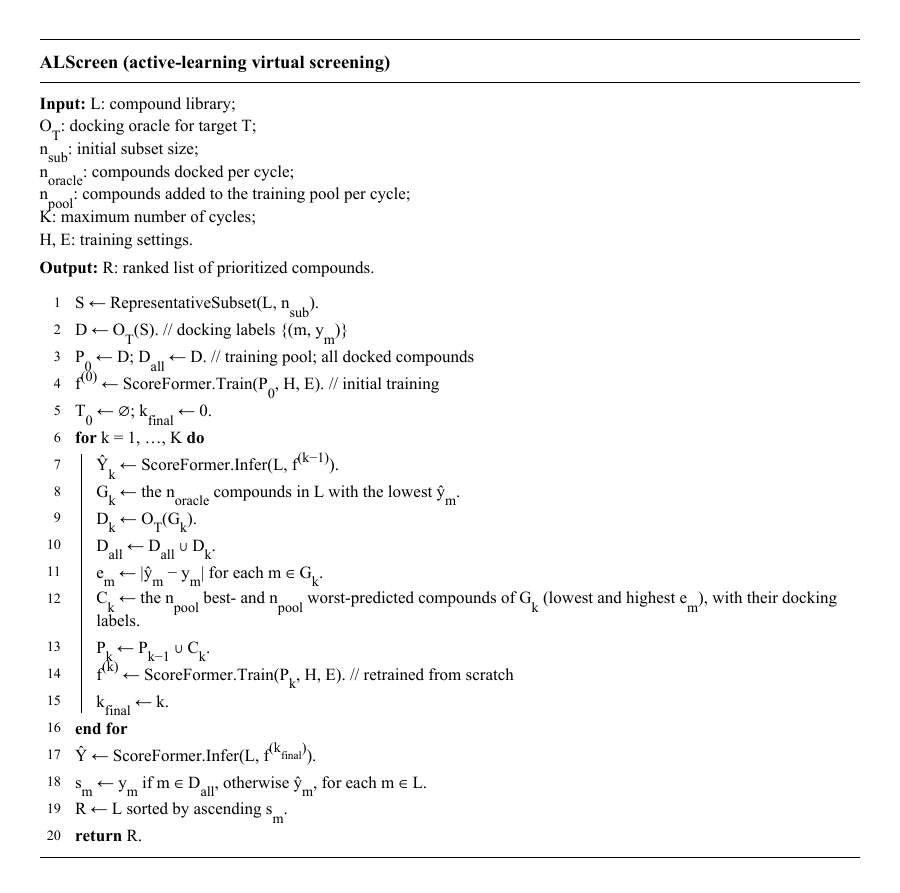

## ALScreen pseudocode

ScoreFormer learns to predict docking scores from molecular structures. 
In each active-learning cycle, ALScreen docks the top-ranked compounds, 
adds examples with both low and high prediction errors to the training pool, and retrains ScoreFormer.

[Open the full pseudocode (PDF)](alscreen_pseudocode.pdf)

