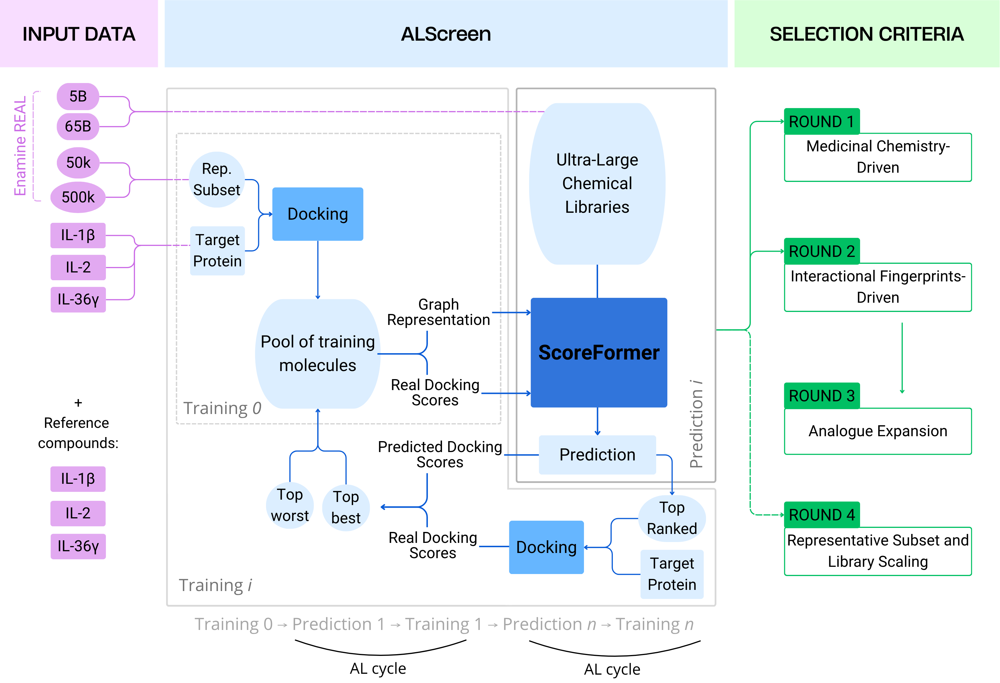

# ALScreenAnalysis

This repository holds the analysis code behind the paper:

> **Stress-testing Billion-Compound Libraries Beyond Druggable Space: Active Learning for Interleukin PPI Disruptors**
>
> *DOI: to be added once the paper is published.*

The study introduces **ALScreen**, an active-learning framework based on the ScoreFormer deep surrogate docking model. It screens ultra-large chemical libraries against three interleukin protein–protein interaction targets: **IL-1β** (PDB 8C3U), **IL-2** (1PY2) and **IL-36γ** (6P9E).

ALScreen was applied to 5 billion compounds from Enamine REAL, with scalability evaluated up to 65 billion compounds. Each active-learning cycle trains on Glide docking scores, predicts scores across the library, docks the top-ranked compounds and adds them to the training pool. Compounds were selected for experimental validation by surface plasmon resonance (SPR) across four rounds using different selection criteria.

The scripts here prepare the datasets and generate the analyses, figures and tables reported in the study.



Each target was screened under two or three docking conditions: `unbias` (no constraints), `bias1` and `bias2` (hydrophobic and/or hydrogen-bond constraints). Their definitions are in [data/README.md](data/README.md).

## Contents in each folder

| Folder | Paper section | What it does |
|---|---|---|
| [ALScreen_processing/](ALScreen_processing/) | **Rounds 1 and 4**, and Supplementary | Glide pose processing, score distributions, prediction errors and statistical comparisons |
| [interaction_fingerprints/](interaction_fingerprints/) | **Round 2**, interaction fingerprint-driven selection | Protein–ligand interaction fingerprints, clustering and interaction frequencies |
| [analogue_analysis/](analogue_analysis/) | **Round 3**, analogue expansion | Analogue library preparation, molecular properties, chemical space, Glide/PELE comparisons and final selection |
| [representative_subset_library_scaling/](representative_subset_library_scaling/) | **Round 4**, representative subset and library scaling | Construction and analysis of a diverse Enamine REAL 5B subset for active-learning seeding |
| [large_libraries_properties/](large_libraries_properties/) | Supplementary | Molecular weight, linearity ratio and unique Bemis–Murcko scaffolds of the 5B and 65B libraries |
| [reference_compounds/](reference_compounds/) | Supplementary | Molecular and affinity-derived properties of known binders and experimentally tested compounds |
| [chemical_diversity/](chemical_diversity/) | Supplementary | Chemotype and scaffold diversity, Sankey diagrams and chemical-space UMAPs |
| [data/](data/) | | Input data and format descriptions |
| [figures/](figures/) | | Workflow figure |

Most analysis figures and tables are written to `results/` folders. Some preparation scripts write beside their inputs or accept an output path. See each folder’s README for details.

## Installation

Create and activate the base environment:

```bash
conda env create -f environment.yml
conda activate alscreen-analysis
```

Additional components are required for particular workflows:

- **Schrödinger installation and license** for `ALScreen_processing/filter_maegz.py`.
- **MolecularAnalysis** for the analogue CSV/SDF/MolDB helpers.
- **TAPNN** and an importable **`utils.comp.calculate_isim`** implementation for the representative-subset workflow.

Check the corresponding folder README for dependencies and configuration. For example, run Maestro pose filtering through the Schrödinger interpreter:

```bash
"$SCHRODINGER/run" ALScreen_processing/filter_maegz.py \
    --maegz glide_pv.maegz -o filtered \
    --metric gscore --metric_threshold -8 --neutral
```

## Data

The analysis data is too large for git and is deposited in Zenodo:

> **Zenodo DOI: to be added.**

Download the archive and extract it into [data/](data/). The expected structure, column names and docking conditions are described in [data/README.md](data/README.md). Additional inputs for analogue and representative-subset analyses are documented in their respective folders.

Library-wide analyses require the Enamine REAL 5B and 65B libraries as partitioned Parquet files. These are distributed by [Enamine](https://enamine.net/compound-collections/real-compounds) and are not redistributed here. Representative-subset construction additionally requires HAC-organised library files and matching population counts.

## Examples of how to run the analyses

Run these examples from the repository root, entering the relevant folder first. Compute intermediate data before running plots that depend on it. Folder READMEs describe inputs, outputs and parameters; scripts accepting arguments also provide `--help`.

### Round 1 and the supplementary docking analysis

Process raw Glide output if necessary, then generate score distributions, prediction errors and statistical comparisons:

```bash
cd ALScreen_processing
python process_glide_csv_output.py --csv glide_output.csv  # optional preparation
python plot_grid_gscore_histograms.py
python prediction_errors.py
python statistical_analysis.py
```

The three analysis scripts read the configured target/bias datasets from `data/ALScreen/` and write to `ALScreen_processing/results/`. They can run independently once the inputs are prepared.

See [ALScreen_processing/README.md](ALScreen_processing/README.md) for additional filtering, ranking and plotting tools, including analyses relevant to Round 4.

### Round 2, interaction fingerprints

Compute fingerprints once from docked poses and a prepared receptor, then reuse the saved file for clustering and analysis:

```bash
cd interaction_fingerprints
python compute_fingerprints.py --target IL1b \
    --pdb ../data/interaction_fingerprints/IL1b/receptor.pdb \
    --sdf ../data/interaction_fingerprints/IL1b/poses.sdf
python analyse_fingerprints.py --target IL1b --ifp results/IL1b_ifp.pkl
```

See [interaction_fingerprints/README.md](interaction_fingerprints/README.md) for input details.

### Round 3, analogue expansion

The workflow prepares analogue libraries, examines molecular properties and chemical space, and selects candidates using Glide scores, visual inspection and PELE improvement relative to the parent hit. Files, hits, constraints and optional thresholds are supplied through a manifest:

```bash
cd analogue_analysis
python pele_plots.py --manifest manifest.csv --output-dir results/pele_plots
python final_selection.py --manifest manifest.csv \
    --output-dir results/final_selection --copy-poses
```

Adapt `manifest.example.csv` to your inputs. See [analogue_analysis/README.md](analogue_analysis/README.md) for library preparation, helper dependencies and selection criteria.

### Round 4, representative subset and library scaling

The representative-subset workflow starts from Enamine REAL 5B and applies HAC-stratified extraction, unique-scaffold selection, physicochemical binning, within-bin fingerprint similarity filtering and balanced merging. The final subset is assessed using iSIM and UMAP.

Run the seven numbered scripts in order. This constructs a diversity-oriented subset; similarity filtering is performed within bins rather than globally. See [representative_subset_library_scaling/README.md](representative_subset_library_scaling/README.md) for the complete workflow and external requirements. Docking-score analysis tools are described in [ALScreen_processing/README.md](ALScreen_processing/README.md).

### Supplementary, reference compounds

Calculate properties for each reference or experimental table before generating the comparison plot:

```bash
cd reference_compounds
python compute_properties.py --input ../data/reference_compounds/IL1b_reference.csv
python compute_properties.py --input ../data/experimental_hits/IL1b_round1.csv \
    --affinity_column KD_uM --affinity_units uM
python plot_strip_plot.py
```

Repeat property calculation for all datasets needed by the plot. See [reference_compounds/README.md](reference_compounds/README.md).

### Supplementary, chemical diversity

Compute chemotypes first, then generate the plots independently:

```bash
cd chemical_diversity
python compute_chemotypes.py
python plot_chemical_diversity.py
python plot_sankey_grid.py
python plot_umap_grid.py
```

### Supplementary, large libraries properties

These analyses process full libraries and are intended for an HPC cluster. Prepare partitioned Parquet inputs and adapt the SLURM account, QoS, environment and resource settings to your cluster.

For example, calculate molecular weights and plot their distributions:

```bash
cd large_libraries_properties
mkdir -p logs
sbatch --array=0-47 run_calculate_mw_database.sh \
    /path/to/Enamine_REAL_65B_parquet results/mw/enamine_65B
sbatch --array=0-6 run_calculate_mw_database.sh \
    /path/to/Enamine_REAL_5B_parquet results/mw/enamine_5B
python plot_mw_database.py results/mw/enamine_5B results/mw/enamine_65B
```

Linearity-ratio and unique-scaffold calculations follow the same submission pattern. Finished partitions are skipped when jobs are resubmitted. Prepare reference-compound properties before plots that overlay them.

See [large_libraries_properties/README.md](large_libraries_properties/README.md) for input preparation and cluster configuration.

## Citation

If you use this code, please cite the paper. The reference and DOI will be added once it is published.

## Contact

Questions about the code or data are welcome:

**Isaac Soul Garcia**, [isaac.soulgarcia@bsc.es](mailto:isaac.soulgarcia@bsc.es)
**Júlia Vilalta Mor**, [julia.vilalta@bsc.es](mailto:julia.vilalta@bsc.es)
**Dr. Isaac Filella-Merce**, [ifilella@nostrumbiodiscovery.com](mailto:ifilella@nostrumbiodiscovery.com)

## Acknowledgments

This project, with reference number CPP2022-009737, has been funded by the State Research Agency (AEI) through the State Program to Promote Scientific-Technical Research and its Transfer, part of the State Plan for Scientific, Technical, and Innovation Research 2021–2023, within the framework of the Recovery, Transformation, and Resilience Plan (Next Generation EU funds).
